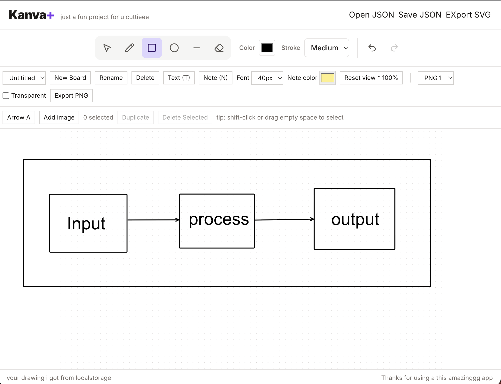

# Kanva

kanva is a site where you can go draw thing for explanation or just for fun . yes its like (excalidraw) but one that i made myself ;)

# LINK

i know u wanna try it out
link : https://kanva.rusil.me

# Motivation

kanva was general curiosity within me asking how can i make excalidraw for myself. i wanted to know how making boxes , drawing works in excalidraw and thought to make it myself. it was not a bad idea. i really enjoyed making this project and learned a lot.

# What i learned

I learned a lot of things how cursor is tracked and a lot amount of if condition i wrote with && or || for checking cursor movement (gestures) to perform action. I learned how to make shapes and how to store them into localstorage in json file and how to store image and a lot moreee

# Project Flow

so here is how project flows all features are in `/features`, inside folder `/whiteboard`. in `/components` have all the components that u see . `/hooks` perform all action that you do , storing , showing etc etc (like backend is hooks and components is frontend but just for imagning cuz we cant say them that) and. lib contains helper function

the components shows the ui, whenever you click anything the component file has onclick function which calls its respective hooks of creating shapes or exporting etc. that hook performs all action and send error or the completed and ui is updated accordingly by the hook

# Did I use ai?

i used ai for ONLY DEBUGGING not writing any codeee.

I wrote all code myself and whenever i got stuck i used to ask for how to do it and DO IT MYSELFF not ask ai to do it for me.

So only thing i asked ai to do for me is fixing linting issue or bugs

## if u liked it pls tell me what u think!! ⭐ the repo if u liked it

# THANK YOU FOR READINGG CUTIE
